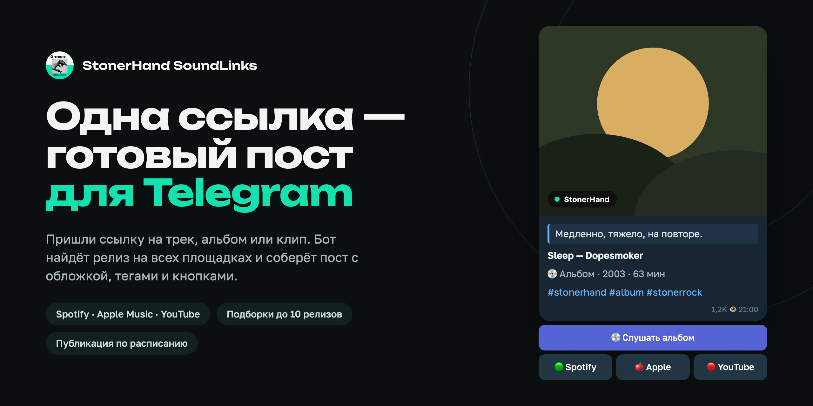
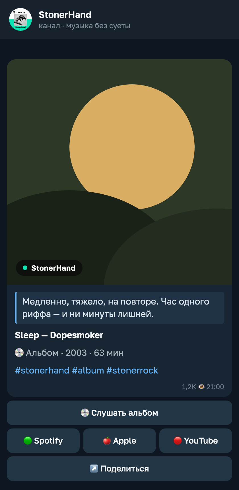
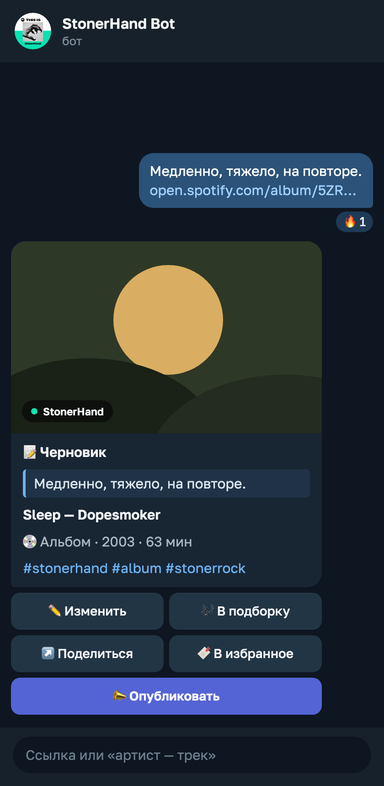
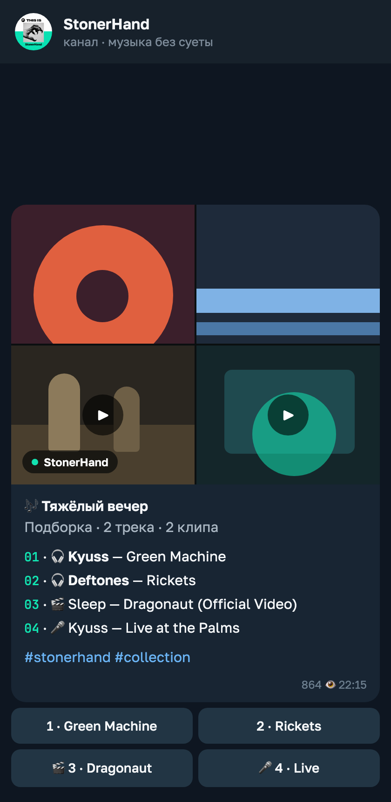
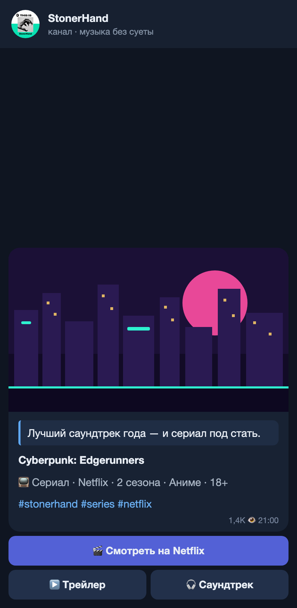

<p align="center">
  
</p>

<h1 align="center">StonerHand SoundLinks</h1>

<p align="center"><strong>One music link in — a publish-ready Telegram post out.</strong></p>

<p align="center">
  <a href="https://t.me/StonerHandBot"><strong>Open the bot ↗</strong></a> ·
  <a href="https://t.me/stonerhand">Channel</a> ·
  <a href="../README.md">Русский</a>
</p>

<p align="center">
  
</p>

## ✨ Features

- 🔗 **Any link or query** — Spotify, Apple Music, YouTube, SoundCloud, Deezer, Tidal, Bandcamp, Yandex Music, NTS, Netflix, Apple TV+, Disney+, or just `artist — track`.
- 🖼 **Posts with artwork** — signed cover, title, year, length, smart tags and buttons for every platform.
- 🎶 **Collections** — up to 10 tracks, albums and videos in one post: a shared collage, a `01 · Artist — Title` list and short buttons.
- 🎬 **Song + videos** — a track with its music videos, live and lyric videos in one post.
- 🍿 **Netflix, Apple TV+ and Disney+ films and series** — a title link becomes a card with a still, seasons or year, genre and "Watch on …", "Trailer" and "Soundtrack" buttons; the soundtrack opens as an album card right in the bot.
- ✏️ **In-chat editor** — your own text, tags, look and buttons; every input prompt has "✕ Cancel".
- 📝 **Your text, uncut** — a quote above the card of up to ~3,900 characters with bold, italic and links; a long one folds to its first lines with "show more". A long post goes out as a message with the cover large on top.
- 📣 **Channel publishing** — now, on a schedule ("tomorrow 18:30") or in one tap; 2 minutes to undo. Every reader sees times in their own time zone.
- 👥 **Groups and channels** — make the bot an admin and a posted link turns into a finished post; `/channel` checks the rights. In groups `/help` and `/channel` answer only you.
- 🎉 **A lively chat** — 👀 → 🔥 reactions on your link, a progress bar with music-themed status lines, confetti on publish and a note when a scheduled post goes out.
- ⚡ **Inline mode** — `@StonerHandBot artist — track` in any chat.
- 🌍 **Russian and English** — follows your Telegram language or the one set in settings.

| Channel post | Draft in the bot | Collection with videos | Netflix series |
| :---: | :---: | :---: | :---: |
|  |  |  |  |

## 🛠 Run your own

Python 3.11+ and a bot token from [@BotFather](https://t.me/BotFather):

```bash
git clone https://github.com/StonerHand/stonerhand-soundlinks-bot.git
cd stonerhand-soundlinks-bot
python -m venv .venv && source .venv/bin/activate
pip install -e ".[dev]"
cp .env.example .env   # set BOT_TOKEN
python -m music_links_bot
```

Production runs on Vercel (webhook) with Upstash Redis for state and Upstash QStash for scheduled posts. The full guide is in Russian: [SETUP.ru.md](SETUP.ru.md), [ARCHITECTURE.ru.md](ARCHITECTURE.ru.md).

[MIT](../LICENSE) © StonerHand
